<p align="center">
  
</p>

# 🎬 Awesome 3D Scene Design & Staging

<p align="center">
  <a href="https://github.com/ishandutta2007/Awesome-Awesome-Awesome"></a><a href="https://discord.gg/jc4xtF58Ve"></a>
  <a href="https://github.com/ishandutta2007/Awesome-3D-Scene-Design-Staging/stargazers"></a>
  <a href="https://github.com/ishandutta2007/Awesome-3D-Scene-Design-Staging/network/members"></a>
  <a href="https://github.com/ishandutta2007/Awesome-3D-Scene-Design-Staging/blob/main/LICENSE"></a>
  <a href="https://github.com/ishandutta2007"></a>
</p>

> 🌟 **A curated directory of top-tier 3D Scene Design & Staging ecosystems, photorealistic render engines, architectural visualization (ArchViz) suites, and open-source spatial composition pipelines.**

**Last updated: October 2026**

---

## 🧭 Overview & Scope

This repository tracks industry-standard **SaaS platforms**, **commercial suites**, and self-hosted **open-source projects** engineered for **3D Scene Design & Staging**. These specialized tools empower product designers, 3D generalists, visualization artists, and architects to compose complex 3D scenes—arranging and staging multi-part models, configuring physically based rendering (PBR) lighting and environmental HDRI probes, camera framing, materials composition, and rendering photorealistic stills or interactive real-time walkthroughs.

Whether you are assembling e-commerce product visualizers, staging architectural interiors, engineering virtual production studios, or generating training scenes for computer vision, this collection highlights both industry enterprise standards and community-driven, cost-effective open-source alternatives.

---

## 📑 Table of Contents

- [📊 Sector Overview & Market Dynamics](#-sector-overview--market-dynamics)
- [🏢 SaaS & Hosted Commercial Platforms](#-saas--hosted-commercial-platforms)
- [🔓 Open-Source GitHub Projects](#-open-source-github-projects)
- [🛠️ Architecture & Pipeline Integration](#️-architecture--pipeline-integration)
- [🤝 How to Contribute](#-how-to-contribute)
- [⭐ Star History](#-star-history)
- [💖 Support](#-support)
- [⚖️ Disclaimer](#️-disclaimer)

---

## 📊 Sector Overview & Market Dynamics

The global 3D rendering and visualization software market is currently estimated between **$7.0B and $8.3B** and is projected to surpass **$20B+ by the early 2030s**, advancing at a compound annual growth rate (CAGR) of ~15% to 20%. Growth is heavily driven by the convergence of real-time GPU rasterization, AI-assisted rendering denoisers, digital twins, and virtual product staging replacing traditional physical photography.

### 🧩 Market Concentration vs. Fragmentation
* **Core Pipeline Concentration (Moderately Concentrated):** Foundational 3D creation and staging environments at the enterprise level are dominated by a select group of industry giants (Adobe, Autodesk, Epic Games, Nemetschek, and Dassault Systèmes) that bundle proprietary formats, materials libraries, and digital asset marketplaces.
* **Periphery & Rendering Engines (Highly Fragmented):** Outside the core CAD/DCC host suites, the rendering and staging space remains intensely fragmented. Specialized render engines (Chaos V-Ray/Corona, Luxion KeyShot, OTOY Octane), indie real-time engines, and robust open-source disruptors (Blender Cycles/EEVEE, Godot, Open3D) prevent single-vendor capture and enable modular, cost-efficient custom pipelines.

---

## 🏢 SaaS & Hosted Commercial Platforms

All pricing and free tier terms reflect current verified manufacturer offerings (sorted descending by company scale and revenue):

| Product | Description | Revenue / Valuation (Company Scale) | Pricing | Free Tier Limit |
| :--- | :--- | :--- | :--- | :--- |
| **[Adobe Substance 3D Stager](https://www.adobe.com/products/substance3d/apps/stager.html)** | Scene assembly and rendering software for product visualizations and mockups. | **~$24B–$26B Revenue** / **~$95B–$105B Market Cap** (Adobe Inc., NASDAQ: ADBE) | **$49.99/month** (billed annually at $599.88/year) or **$59.99/month** (month-to-month) for Substance 3D Collection | **30-day free trial** with full suite access (Stager, Painter, Designer, Sampler) and select asset downloads; requires payment method on sign-up; no permanent free tier. |
| **[Twinmotion (Epic Games)](https://www.twinmotion.com/)** | Real-time architectural visualization tool built on Unreal Engine. | **~$5.3B–$5.7B Revenue** / **~$22.5B Valuation** (Epic Games) | **$445/seat per year** (Commercial tier for businesses with over $1M annual gross revenue) | **Free forever plan** for students, educators, individuals, and businesses generating under **$1,000,000 in annual gross revenue** (all core features included; Twinmotion Cloud publishing requires paid seat). |
| **[Cinema 4D](https://www.maxon.net/)** | Professional 3D modeling, animation, and rendering suite from Maxon. Includes Redshift GPU renderer. | **~$1.3B–$1.5B Revenue** / **~$9B–$10B Market Cap** (Nemetschek Group, ETR: NEM) | **$69.91/month** (billed annually at $838.92/year) or **$109.00/month** (month-to-month) | **14-day free trial** (via Maxon One trial) with full feature access and unwatermarked renders; no credit card required; no permanent free tier. |
| **[V-Ray (Chaos)](https://www.chaos.com/)** | Industry-standard photorealistic renderer for 3ds Max, Maya, Cinema 4D, and more. | **~$130M+ ARR (Est.)** / Backed by TA Associates & Enscape Merger (Chaos Group) | **$45.00/month** (billed annually at $540.00/year) or **$82.90/month** (month-to-month) for V-Ray Solo | **30-day free trial** with full feature access, unwatermarked rendering, and access to up to 15,000 Chaos Cosmos assets; requires account sign-up; no permanent free tier. |
| **[Corona Renderer (Chaos)](https://www.chaos.com/corona)** | CPU-based photorealistic renderer popular for architectural visualization. | **~$130M+ ARR (Est.)** / Backed by TA Associates & Enscape Merger (Chaos Group) | **$34.50/month** (billed annually at $414.00/year) or **$59.90/month** (month-to-month) for Corona Solo | **30-day free trial** with full engine access, no watermarks, full resolution, and access to Chaos Cosmos asset library; requires checkout sign-up; no permanent free tier. |
| **[KeyShot](https://www.keyshot.com/)** | Real-time ray tracing renderer for product design and visualization. | **~$25M–$32M ARR** / Backed by GRO Capital (Luxion Group) | **$108.25/month** (billed annually at $1,299.00/year) for KeyShot Pro | **14-day free trial** with Pro feature set access; render outputs are watermarked, and save/queue capabilities are restricted; no permanent free tier. |
| **[Lumion](https://lumion.com/)** | Architectural rendering software with real-time visualization and a large asset library. | **~$25M–$27M ARR (€23M–€25M)** / Backed by Seven2 (Act-3D B.V.) | **$96.00/month** (billed annually at $1,149.00/year) for Lumion Standard | **14-day free trial** (Lumion Pro trial) with unrestricted export resolution up to 8K, but outputs include a visible trial watermark and access to ~15% of the content library; no permanent free tier. |
| **[Marmoset Toolbag](https://marmoset.co/)** | Real-time rendering, baking, and presentation suite for 3D artists. | **~$3M–$15M Revenue** (Marmoset LLC) | **$18.99/month** (subscription) or **$399.00 one-time** (perpetual license) for Individual tier | **30-day free trial** for personal evaluation with full features unlocked; exports carry a mandatory trial watermark; strictly non-commercial; no permanent free tier. |
| **[Spline 3D](https://spline.design/)** | Collaborative browser-based 3D scene design, animation, and web staging tool. | **~$5M–$7M ARR** / **~$32M Total Funding** (Spline Inc.) | **$12.00/seat per month** (billed annually at $144.00/year) or **$15.00/month** for Hobby tier | **Free forever plan** with unlimited personal files, unlimited viewers, and interactive web exports (exports and public viewer links carry a Spline watermark; limited to basic AI credits). |
| **[Clara.io](https://clara.io/)** *(Legacy Reference)* | Browser-based 3D modeling, animation, and rendering software. | Historical startup asset; acquired/transitioned to Threekit ($15M+ ARR) | Service retired (previously offered Basic free tier and $10/month Standard tier) | Platform officially **sunset on December 31, 2022**; no active free or paid access. Included for historical scene-staging categorization. |

---

## 🔓 Open-Source GitHub Projects

The open-source 3D staging ecosystem provides self-hosted, vendor-lock-free alternatives for production scene layout, physical lighting, camera sequencing, and asset baking. 

Repositories are **ranked in descending order by GitHub Stars**:

1. **[Godot Engine](https://github.com/godotengine/godot)** [](https://github.com/godotengine/godot/stargazers)  
   🎮 **The leading open-source 2D/3D engine and real-time scene compositor.** Features a node-based spatial tree, advanced 3D viewport with interactive gizmos, real-time Forward+ and mobile Vulkan renderers, SDFGI (Signed Distance Field Global Illumination), Volumetric Fog, and VoxelGI. Widely adopted for interactive real-time staging, interactive architectural walkthroughs, and spatial product presentations.

2. **[FreeCAD](https://github.com/FreeCAD/FreeCAD)** [](https://github.com/FreeCAD/FreeCAD/stargazers)  
   📐 **Parametric open-source 3D CAD modeler.** Designed for mechanical engineering, product design, and BIM architectural scenes requiring millimeter precision. Features dedicated Render and TechDraw workbenches capable of exporting scene geometry directly into Raytracing engines (LuxCore, POV-Ray, Blender Cycles) for dimensioned technical staging.

3. **[Blender](https://github.com/blender/blender)** [](https://github.com/blender/blender/stargazers)  
   🎨 **The undisputed flagship open-source 3D production suite.** Provides complete scene assembly, physics simulation, multi-pass compositing, and rendering via **Cycles** (unbiased, physically based path tracer) and **EEVEE Next** (real-time GPU rasterizer). A fully unrestricted, permanently free alternative to Cinema 4D, 3ds Max, and Maya for high-end studio lighting, product staging, and architectural visualization.

4. **[Open3D](https://github.com/isl-org/Open3D)** [](https://github.com/isl-org/Open3D/stargazers)  
   🔬 **Modern open-source library for 3D data processing, scene reconstruction, and spatial visualization.** Offers rapid C++ and Python APIs for point cloud alignment, mesh editing, physically based rendering (PBR), and interactive 3D scene visualizers. Crucial for robotics, autonomous vehicle simulation scenes, and photogrammetry staging.

5. **[Nerfstudio](https://github.com/nerfstudio-project/nerfstudio)** [](https://github.com/nerfstudio-project/nerfstudio/stargazers)  
   📸 **End-to-end framework for Neural Radiance Fields (NeRF) and 3D Gaussian Splatting scene staging.** Features an interactive real-time web visualizer allowing creators to stage camera flythrough trajectories, tune near/far planes, adjust lighting exposure, and export high-resolution cinematic video renders from real-world captured spaces.

6. **[OpenSCAD](https://github.com/openscad/openscad)** [](https://github.com/openscad/openscad/stargazers)  
   💻 **The programmers' solid 3D CAD modeler.** Employs a pure functional code-based approach (CSG - Constructive Solid Geometry) to compile parametric 3D parts and staging rigs. Ideal for algorithmic scene generation, repeatable product assembly mockups, and modular scene framing.

7. **[ArmorPaint](https://github.com/armory3d/armorpaint)** [](https://github.com/armory3d/armorpaint/stargazers)  
   🖌️ **Stand-alone open-source 3D PBR texture painting software.** Powered by the ArmorCore engine with hardware-accelerated ray tracing viewport previews. Enables visualization artists to texture, inspect, and bake multi-material assets before dropping them directly into Blender or Godot scene staging layouts.

8. **[Dust3D](https://github.com/huxingyi/dust3d)** [](https://github.com/huxingyi/dust3d/stargazers)  
   ⚡ **Rapid 3D modeling and blockout staging software.** Enables designers to create watertight 3D base meshes, auto-generate UVs, and establish scene scale and character proportions within minutes, accelerating initial staging iterations before final detail sculpture.

9. **[appleseed](https://github.com/appleseedhq/appleseed)** [](https://github.com/appleseedhq/appleseed/stargazers)  
   🍎 **Production-oriented, open-source physically based global illumination rendering engine.** Tailored for animation, architectural visualization, and VFX studios. Integrates fully with Blender and Maya, featuring modern OSL (Open Shading Language) support, advanced spectral light transport, and depth-of-field staging controls.

10. **[PlayCanvas Editor](https://github.com/playcanvas/editor)** [](https://github.com/playcanvas/editor/stargazers)  
    🌐 **Visual browser-based WebGL/WebGPU 3D scene editor.** Offers collaborative scene assembly, real-time lighting previews, entity-component transforms, hierarchy inspector, and instant publishing for interactive web 3D product configurations.

11. **[LuxCoreRender](https://github.com/LuxCoreRender/LuxCore)** [](https://github.com/LuxCoreRender/LuxCore/stargazers)  
    💎 **Unbiased, physically based ray tracing and spectral rendering engine.** Renowned for unmatched architectural glass rendering, caustics simulation, and photon mapping. Delivers plug-and-play staging workflows through its dedicated Blender-LuxCore addon.

12. **[CozyClay](https://github.com/NomaDamas/CozyClay)** [](https://github.com/NomaDamas/CozyClay/stargazers)  
    🎭 **Lightweight browser-based 3D staging and character posing studio.** Built with Three.js and React Three Fiber. Features W/E/R 3D gizmo transforms, camera fly controls (WASD/QE), plan-view staging grids, timeline prompt sequencing, and optional local AI motion generation via ARDY.

---

## 🛠️ Architecture & Pipeline Integration

To achieve professional visual fidelity without enterprise subscription overhead, production teams combine open-source tools into cohesive staging pipelines:

```
[ Concept / Precision CAD ]
  ├── FreeCAD (Dimensional engineering & CAD STEP assemblies)
  └── Dust3D / OpenSCAD (Rapid prototyping & parametric blockout)
                │
                ▼
[ Texturing & Asset Prep ]
  └── ArmorPaint (PBR material painting & multi-channel baking)
                │
                ▼
[ Scene Assembly & Staging Layout ]
  ├── CozyClay (Rapid browser scene blocking & character posing)
  └── PlayCanvas Editor (Interactive web 3D configuration staging)
                │
                ▼
[ Final Rendering & Presentation ]
  ├── Blender Cycles / EEVEE (Photorealistic product renders & ArchViz walkthroughs)
  ├── LuxCoreRender (High-fidelity architectural caustics & glass)
  └── Godot Engine / Nerfstudio (Real-time interactive tours & neural flythroughs)
```

---

## 🤝 How to Contribute

Contributions from the 3D visualization, architectural design, and open-source communities are warmly welcome!

1. 🍴 **Fork the repository** on GitHub.
2. 🌿 **Create a feature branch**: `git checkout -b feature/add-new-staging-tool`
3. 📝 **Add or update entries**: Ensure factual accuracy, links to official documentation or source code, verified pricing/tiers, and GitHub star badges (`style=social&color=white`).
4. 🚀 **Commit your changes**: `git commit -m 'Add ToolName to 3D Scene Design & Staging'`
5. 📬 **Open a Pull Request** with a concise description of why the tool is beneficial to 3D designers and staging artists.

---

## ⭐ Star History

[](https://star-history.dera.page/#ishandutta2007/Awesome-3D-Scene-Design-Staging&type=date&legend=top-left)

---

## 💖 Support

Thank you for exploring and supporting **Awesome 3D Scene Design & Staging**! 🚀

If this curated repository saved you time, broadened your rendering pipeline knowledge, or helped you discover open-source alternatives, please consider:
- ⭐ **Starring** the repository on GitHub to boost discovery.
- 🍴 **Forking** and contributing your favorite workflows, tools, or tips.
- 📢 **Sharing** with fellow 3D artists, architects, and developers.
- ☕ **Sponsoring the maintainer** or buying a coffee via the [GitHub Sponsor Dashboard](https://github.com/sponsors/ishandutta2007).

Your sponsorship directly supports ongoing maintenance, market research updates, and new open-source resource curation.

---

## ⚖️ Disclaimer

- This is an **independent, community-curated** reference list—not an official commercial endorsement.
- **Blender** remains the only fully featured, permanently free, open-source 3D suite with zero license restrictions covering the entire scene design and photorealistic rendering production pipeline.
- **Twinmotion** offers a generous free tier for individuals and businesses generating under $1M in annual gross revenue; above that threshold, commercial seats are required.
- Software specifications, pricing structures, and cloud capabilities are accurate as of October 2026 and subject to vendor modification; always verify current licensing agreements on official vendor platforms.

---

<p align="center">
  <b>Crafted with ❤️ for 3D Generalists, Product Designers, Visualization Artists, and Spatial Pipeline Architects worldwide.</b>
</p>
